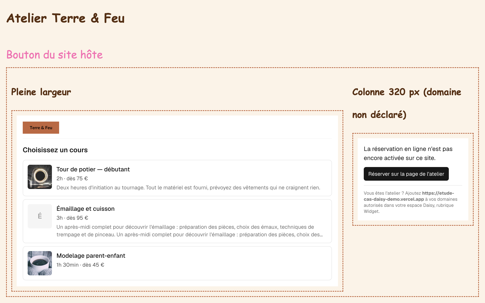
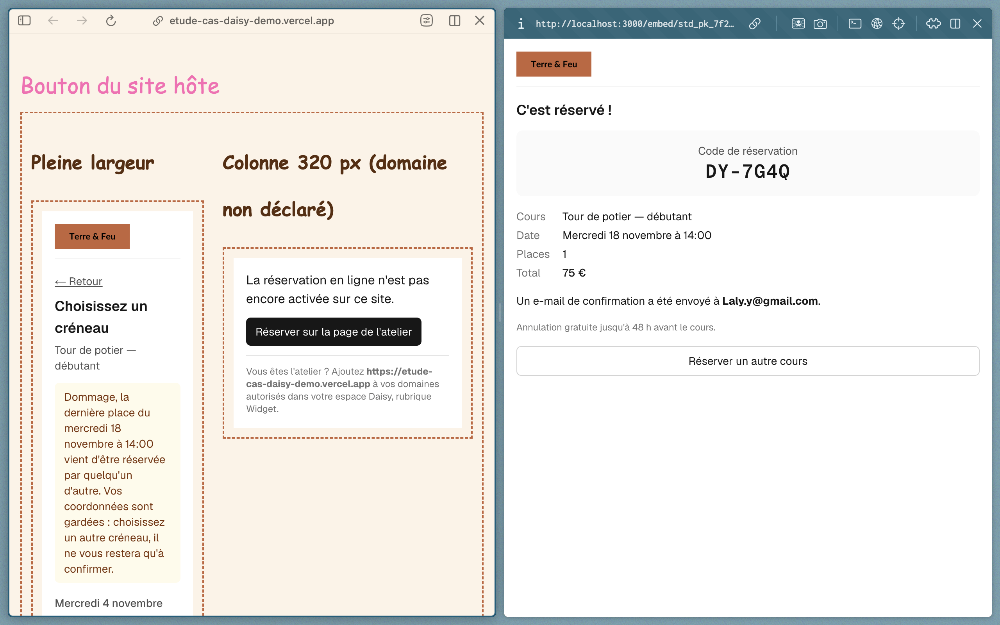

# Widget de réservation Daisy — Sujet B

L'artisan colle deux lignes sur son site (Wix, Squarespace, WordPress, site fait main) et un tunnel de réservation apparaît : cours, créneau, coordonnées, confirmation.

- Démo sur un site d'artisan (autre domaine, CSS agressif) : https://etude-cas-daisy-demo.vercel.app
- Widget seul et cas de test : https://etude-cas-daisy-khi4.vercel.app

```html
<div id="daisy-booking" data-studio="std_pk_7f2a9c"></div>
<script src="https://etude-cas-daisy-khi4.vercel.app/embed.js" async></script>
```



## Architecture

```text
Site de l'artisan (n'importe quel domaine)
 └─ embed.js ─────────────── loader en JS pur, sans dépendance
     └─ <iframe> /embed/[studioKey] ── le tunnel (Next.js, React)
         └─ /api/v1/* ───────────── réplique de l'API Daisy (route handlers Next.js)
             └─ Supabase (Postgres) ── create_booking : réservation atomique et idempotente
```

Stack : Next.js (App Router), TypeScript, Tailwind, Supabase (Postgres), Vercel.

Le widget ne parle qu'à `/api/v1` via un client isolé (`src/lib/daisy/client.ts`). Remplacer cette réplique par la vraie API Daisy ne demanderait de changer qu'une ligne : l'URL de base du client.

## Les questions

### 1. CSS agressif de l'hôte : comment garantir l'affichage, et à quel prix ?

**Une iframe**, la seule isolation totale. Le Shadow DOM laisse passer les propriétés héritées (`font`, `line-height`…) : le `body { line-height: 2.5 !important }` de la démo s'y infiltre. Sur 70 ateliers et des centaines de thèmes, je préfère une garantie à un « presque partout ».

Le loader complète l'iframe : JS pur, styles inline `!important` (seuls à battre un `iframe { height: 150px !important }`), plusieurs widgets par page (vérification de `event.origin` et `event.source`), `MutationObserver` pour les éditeurs qui injectent le conteneur tard, et **lien de secours après 15 s** si l'iframe ne répond pas (testé avec une CSP qui bloque les iframes).

| Prix | Compensation |
|---|---|
| L'iframe ignore sa hauteur | `ResizeObserver` + `postMessage`, mesuré sur un conteneur (sinon elle ne rétrécit jamais) |
| Rien ne déborde du cadre | Tunnel linéaire, sans élément flottant |
| Défilement de l'hôte non piloté | Le widget demande au loader de remonter à chaque étape |
| Pas d'héritage de la police | Voulu (lisibilité), voir question 2 |
| L'API ne voit plus le domaine | Le loader transmet l'origine (voir « Domaine non déclaré ») |

Limite : l'iframe protège le widget, pas la colonne que l'hôte lui donne.

### 2. « Moche sur mobile » et ses couleurs : jusqu'où personnaliser ?

« Moche sur mobile » est un bug, pas une demande de personnalisation : avec 60 % de trafic mobile, on le corrige pour les 70 ateliers.

Pour l'identité, des réglages, pas du code : une couleur principale avec contrôle de contraste automatique, son logo, éventuellement 3 ou 4 polices testées. Pas de CSS libre : chaque mise à jour casserait des personnalisations, on ne peut pas tester 70 variantes, et une correction faite une fois profite à tous.

**Implémenté** : contraste WCAG 2 calculé par le widget. La terre cuite `#C4643A` n'offre que 4,0:1 avec du blanc (seuil 4,5:1), le texte du bouton passe donc en noir (5,2:1). Une couleur trop claire pour une bordure (< 3:1) reste réservée au bouton. Logo s'il existe, nom de l'atelier sinon.

### 3. La dernière place part pendant la saisie : que voit l'utilisateur ?

Il revient aux créneaux, la liste est rechargée (« Complet ») et il lit :

> Dommage, la dernière place du samedi 14 novembre à 14:00 vient d'être réservée par quelqu'un d'autre. Vos coordonnées sont gardées : choisissez un autre créneau, il ne vous restera qu'à confirmer.

Pas d'« erreur », le créneau est nommé, l'utilisateur est rassuré sur ses données, l'action suivante a un coût clair. Et c'est vrai : le formulaire est pré-rempli au créneau suivant.

Cas voisins : places partiellement prises (nombre ajusté, total recalculé), créneau annulé par l'atelier (message dédié, coordonnées gardées).

Côté serveur, c'est Postgres qui arbitre : `UPDATE slots SET seats_available = seats_available - n WHERE id = … AND seats_available >= n`, avec `CHECK (seats_available >= 0)` en filet. Deux demandes simultanées se sérialisent sur la ligne, la seconde ne met rien à jour. **Testé avec deux onglets sur la même dernière place (production contre local, même base) : une seule réservation enregistrée.**



*À gauche, la démo en production ; à droite, un second onglet en local. Même base : c'est Postgres qui arbitre.*

### 4. Quel indicateur en production ?

**Le taux de conversion du tunnel par étape** (affiché → cours → créneau → formulaire → confirmé), segmenté par atelier, appareil et plateforme hôte. Il dit où ça casse et chez qui.

Garde-fous :
- installations qui n'affichent jamais le widget (`daisy:ready` absent, lien de secours, `403 origin_not_allowed`) : on peut contacter l'atelier avant qu'il ouvre un ticket ;
- échecs d'envoi par cause : un `409` en hausse est un signal produit, un `5xx` un incident ;
- latence p95 du `POST /bookings` (1,5 à 4 s de base).

Le widget émet déjà `daisy:booking_confirmed` vers l'hôte, sans donnée personnelle.

## Domaine non déclaré (un artisan sur trois l'oublie)

Dans une iframe, les requêtes partent du domaine Daisy : l'API ne voit plus le site de l'artisan. Le loader lit `location.origin` et le passe à l'iframe (`?host=`) ; le widget le renvoie à l'API dans un en-tête `x-daisy-host`, comparé aux domaines déclarés.

Écartés : `document.referrer` (vidable par la Referrer-Policy de l'hôte) et `location.ancestorOrigins` (absent de Firefox, bon contrôle complémentaire ailleurs).

En cas de 403, le cadre affiche « La réservation en ligne n'est pas encore activée sur ce site », un bouton pour réserver en pleine page, et « Ajoutez `{host}` à vos domaines autorisés », où `{host}` est l'origine détectée (ex. `https://atelier-dupont.fr`). Le visiteur ne perd pas sa réservation, l'artisan sait quoi corriger.

Limite assumée : le paramètre est falsifiable, mais la clé est publique et le contrôle sert à guider. En production, la vérification se ferait dans le loader, dont la requête porte un `Origin` garanti par le navigateur.

## Autres choix techniques

- **Réservation** : une seule fonction Postgres (`create_booking`), donc une seule transaction : contrôles, décrément atomique, enregistrement. La clé d'idempotence est unique en base : un nouvel essai après coupure renvoie la même réservation. Tables sous RLS sans policy, accessibles uniquement depuis le serveur.
- **Envoi** : déclenché au clic (pas dans un `useEffect`, exécuté deux fois en dev), `Idempotency-Key`, timeout 15 s, message rassurant au-delà de 2,5 s, total venant du serveur.
- **Formulaire mobile** : `autocomplete` partout, champs en 16 px (pas de zoom iOS), téléphone « 06 12… » converti en +33, nombre de places plafonné.
- **Créneaux** : heure de l'atelier avec mention si le fuseau diffère, créneaux complets visibles mais désactivés, fenêtres de 4 semaines, recherche insensible aux accents au-delà de 8 cours.
- **Accessibilité** : focus sur le titre à chaque étape, `aria-live`, `aria-invalid`, clavier, `lang="fr"`.

## Limites et suites

- Rate limit en mémoire, un compteur par instance Vercel → Redis ou table dédiée.
- Places non mises à jour en temps réel : le `409` bien géré couvre le cas qui compte.
- Brouillon perdu au rechargement → `sessionStorage`.
- Si `embed.js` ne charge pas, le cadre reste vide → mettre un lien « Réserver en ligne » dans la div, remplacé par le loader.
- Paramètres `?mock=` à retirer d'une API réelle.
- **Pas de tests automatisés** : tout testé à la main. Prochaine étape : Playwright.

**Testé à la main** : CSS agressif, deux widgets sur une page, colonne de 320 px, iPhone, domaine non déclaré, CSP bloquant les iframes, 45 cours, autre fuseau, formulaire vide, couleurs claires et foncées, logo absent, coupure réseau, nouvel essai idempotent, dernière place prise (deux onglets, production contre local), places partiellement prises, créneau annulé en base pendant la saisie, persistance après redémarrage.

**Bugs trouvés et corrigés** : numéro à 9 chiffres accepté ; après un échec, le téléphone s'affichait en +33… au lieu de la saisie.

## Lancer en local

```bash
npm install
npm run dev                                        # widget
python3 -m http.server 5500 --directory public     # page hôte de test
```

Ouvrir http://localhost:5500/demo-host.html.

Base : créer un projet Supabase, exécuter dans l'ordre `supabase/01_schema.sql`, `02_create_booking.sql` et `03_seed.sql`, puis renseigner `SUPABASE_URL` et `SUPABASE_SECRET_KEY` dans `.env.local`.

Scénarios forcés, déclenchés à l'envoi : `?mock=slot_full`, `?mock=slot_cancelled`, `?mock=rate_limited` (ex. `http://localhost:3000/embed/std_pk_7f2a9c?mock=slot_cancelled`).


